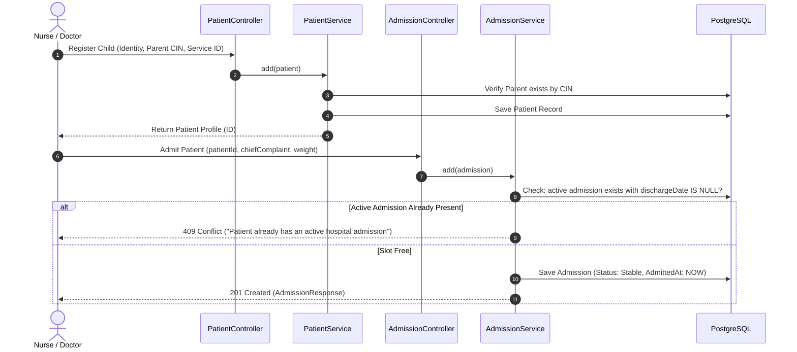
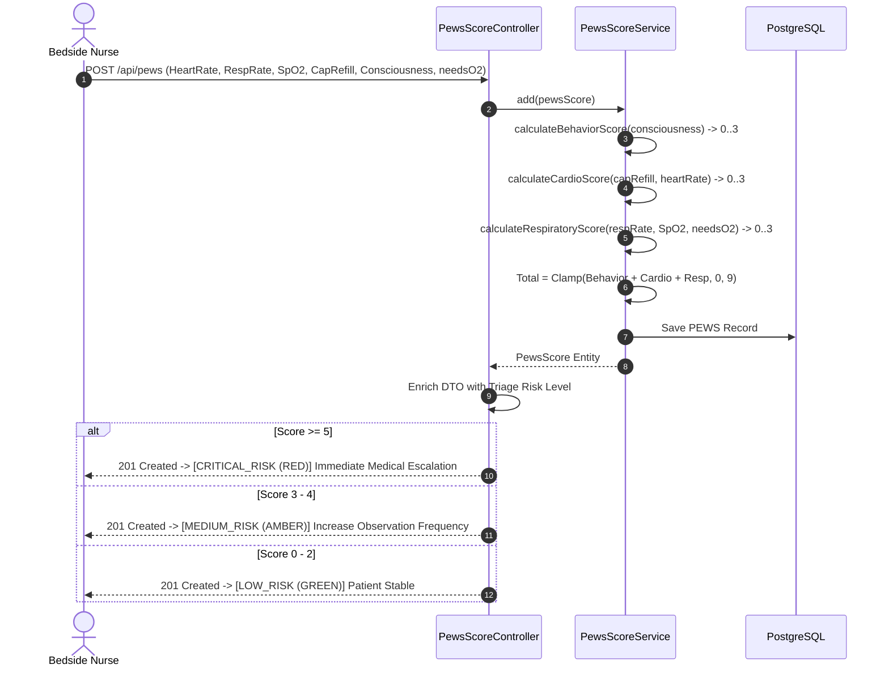
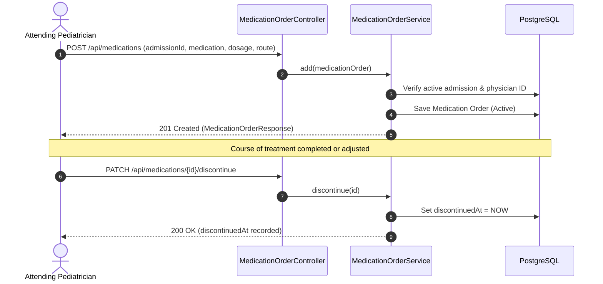

# Mawadda (مودة) — Pediatric Hospital Clinical Information System

> **Academic Project**  
> **Course:** Advanced Java & Enterprise Software Architecture  
> **Academic Level:** 2nd Year Engineering (Software / Computer Engineering)  
> **Framework & Runtime:** Java 17 LTS & Spring Boot 3.3.4  

---

## 1. General Project Idea

In pediatric hospital environments, children require clinical oversight that differs fundamentally from adult healthcare. Physiological vitals vary drastically by age, medical records must link to verified legal guardians via National Identity Card (CIN), and clinical teams need automated early warning systems to detect rapid pediatric deterioration before it becomes fatal.

**Mawadda** is an enterprise-grade Pediatric Hospital Information System (HIS / Dossier Patient Informatisé) developed with **Spring Boot 3.3.4** and **PostgreSQL**. Its objectives are:
1. **Digitize the Inpatient & Outpatient Lifecycle:** Manage pediatric patient identity, admissions, clinical notes, and discharge workflows.
2. **Guardian Linkage & Identity Security:** Enforce legal accountability by linking pediatric patients to authenticated parents/guardians using unique national CIN identification.
3. **Departmental Service Isolation:** Support hospital wards (Neonatology, Pediatric Surgery, ICU, etc.) with secure invite-code-based staff onboarding.
4. **Clinical Decision Support via PEWS:** Implement the **Pediatric Early Warning System (PEWS)** scoring algorithm to compute composite deterioration scores (0–9) and classify vital signs into standardized triage alerts (**Green**, **Amber**, **Red**).

---

## 2. Project Modules

The application is architected into **10 decoupled, domain-driven modules**:

```
src/main/java/com/mawadda/
├── enums/                      # Domain Enumerations (Role, BloodType, Sex, Severity, etc.)
├── entity/                     # JPA Model Entities with Hibernate Mappings
├── repository/                 # Spring Data JPA Repository Interfaces
├── service/                    # Business Service Interfaces (CRUD: add, modify, show, delete)
│   └── impl/                   # Business Service Implementations (@Service, @Transactional)
├── controller/                 # REST API Controllers (@RestController, @RequestMapping)
├── dto/                        # Immutable Data Transfer Objects (Java Records with Bean Validation)
├── config/                     # SecurityConfig, OpenApiConfig, CorsConfig
└── exception/                  # Global Exception Handler (@RestControllerAdvice)
```

| Module | Package / Endpoint | Core Purpose |
|---|---|---|
| **1. Staff Users** | `/api/users` | Medical staff identity, role-based access, password hashing. |
| **2. Medical Services** | `/api/services` | Hospital wards/departments, invite code management. |
| **3. Parents & Guardians** | `/api/parents` | Legal guardian registry linked by unique national CIN. |
| **4. Pediatric Patients** | `/api/patients` | Child clinical identity, birth details, gestational history. |
| **5. Inpatient Admissions** | `/api/admissions` | Hospital stay intake, bed monitoring, discharge flow. |
| **6. PEWS Triage Engine** | `/api/pews` | Vital sign recording, auto-scoring, and risk classification. |
| **7. Clinical Diagnoses** | `/api/diagnoses` | Admitting, working, and resolved diagnostic entries. |
| **8. Medication Orders** | `/api/medications` | Prescription management, pediatric dosing, discontinuation. |
| **9. Allergy Registry** | `/api/allergies` | Allergen cataloging, reaction severity, patient safety alerts. |
| **10. Surgical History** | `/api/surgical-history` | Past surgical procedures, anatomic sites, and complications. |

---

## 3. Module Functionalities

### Module 1: Staff User Management (`/api/users`)
* **Account Provisioning:** Create staff accounts with roles (`Chef`, `Doctor`, `Nurse`, `Intern`).
* **Secure Storage:** Automatic password encryption using Spring Security's `BCryptPasswordEncoder`.
* **Department Affiliation:** Attach staff to specific hospital medical services.
* **Lookup & Filtering:** Query staff members by database ID or email address.

### Module 2: Medical Service / Department Management (`/api/services`)
* **Department Registration:** Create medical units (e.g., *Neonatology ICU*, *Pediatric Cardiology*).
* **Cryptographic Invite Codes:** Generate unique 6-character tokens (`ABCDEF...`) for department assignment.
* **Service Discovery:** Resolve service metadata via ID or invite code.

### Module 3: Parent & Legal Guardian Management (`/api/parents`)
* **Guardian Registration:** Register legal guardians uniquely identified by National CIN.
* **Emergency Contacts:** Store primary phone number, secondary emergency contact, and address.
* **Family Linking:** Retrieve all children linked to a specific parent's CIN.

### Module 4: Pediatric Patient Management (`/api/patients`)
* **Identity Registration:** Record full name, sex (`Male`, `Female`, `Intersex`), and blood type.
* **Perinatal Baseline:** Track birthdate, birth weight (kg), gestational age (weeks), birth delivery type (`Vaginal`, `Cesarean`), and obstetric complications.
* **Department Assignment:** Link child to the primary medical service managing their care.

### Module 5: Inpatient Admission Management (`/api/admissions`)
* **Bed Intake:** Admit a pediatric patient with chief complaint, current weight, and status (`Stable`, `Observation`, `Critical`).
* **Single Active Stay Constraint:** Business rule enforcing that a patient can have **at most one active admission** at any time.
* **Discharge Handling:** Record discharge timestamp, update status to `Discharged`, and free the bed.

### Module 6: PEWS Clinical Triage Engine (`/api/pews`)
* **Vital Signs Intake:** Heart rate, respiratory rate, oxygen saturation (SpO2), temperature, capillary refill time, consciousness level, and oxygen therapy requirement.
* **Algorithmic Sub-Score Calculation:** Automatically evaluates:
  * **Behavior Score (0–3):** Derived from consciousness state (*Alert* = 0, *Irritable/Sleeping* = 1, *Lethargic* = 2, *Comatose/Pain* = 3).
  * **Cardiovascular Score (0–3):** Evaluated from capillary refill time and heart rate limits.
  * **Respiratory Score (0–3):** Evaluated from respiratory frequency, oxygen saturation thresholds, and supplemental O2.
* **Triage Risk Output:** Total composite score (0–9) mapped to clinical severity:
  * `0 - 2`: **LOW_RISK (GREEN)** — Routine monitoring.
  * `3 - 4`: **MEDIUM_RISK (AMBER)** — Increased nursing observation.
  * `5 - 9`: **CRITICAL_RISK (RED)** — Immediate pediatric emergency escalation.
* **Clinical Error Audit:** Mark mistaken entries with mandatory justification reasons (`isError = true`).

### Module 7: Clinical Diagnoses (`/api/diagnoses`)
* **Diagnosis Logging:** Track medical diagnoses categorized as `ADMITTING`, `WORKING`, or `RESOLVED`.
* **Medical Traceability:** Record attending doctor ID and timestamp for medical-legal compliance.

### Module 8: Medication Prescription Orders (`/api/medications`)
* **Prescription Logging:** Drug name, pediatric dosage, route (IV, PO, IM, Inhalation).
* **Discontinuation:** Mark active treatments as discontinued with audit timestamps.

### Module 9: Allergy Registry (`/api/allergies`)
* **Adverse Reaction Tracking:** Record allergen, symptomatic reaction, and severity (`Low`, `Moderate`, `Severe`, `Fatal`).
* **Patient Safety:** Instant visibility of critical sensitivities to prevent contraindications.

### Module 10: Pediatric Surgical History (`/api/surgical-history`)
* **Past Procedure Tracking:** Surgical intervention name, body site, procedure date, and documented complications.

---

## 4. Project Actors

The platform defines **4 primary healthcare actors**:

| Actor | Professional Profile | Responsibilities |
|---|---|---|
| **Chef de Service (Department Chief)** | Senior Consultant / Department Head | Department setup, invite code management, clinical audit, user oversight. |
| **Doctor (Pediatrician / Specialist)** | Attending Physician | Diagnostic decisions, medication prescriptions, patient discharge, surgical review. |
| **Nurse (Pediatric Nurse)** | Bedside Nursing Staff | Vital sign recording, PEWS triage assessment, allergy logging, daily patient care. |
| **Intern (Medical Resident / Intern)** | Trainee Physician | Initial clinical workup, logging working diagnoses, preliminary vitals under supervision. |

---

## 5. Functional Access Matrix

| Module / Action | Chef | Doctor | Nurse | Intern |
|---|:---:|:---:|:---:|:---:|
| **Create Service & Manage Invite Codes** | ✅ | ❌ | ❌ | ❌ |
| **Register & Manage Staff Users** | ✅ | ❌ | ❌ | ❌ |
| **Register Parent / Legal Guardian** | ✅ | ✅ | ✅ | ✅ |
| **Register Pediatric Patient & Birth Data** | ✅ | ✅ | ✅ | ✅ |
| **Inpatient Admission Intake** | ✅ | ✅ | ✅ | ✅ |
| **Record PEWS Vitals & Run Triage Algorithm** | ✅ | ✅ | ✅ | ✅ |
| **Mark PEWS Score as Recorded in Error** | ✅ | ✅ | ❌ | ❌ |
| **Prescribe Medication Orders** | ✅ | ✅ | ❌ | ❌ |
| **Discontinue Medication Orders** | ✅ | ✅ | ❌ | ❌ |
| **Log Admitting & Resolved Diagnoses** | ✅ | ✅ | ❌ | ⚠️ (*Working only*) |
| **Log Patient Allergies** | ✅ | ✅ | ✅ | ✅ |
| **Log Surgical History** | ✅ | ✅ | ❌ | ❌ |
| **Discharge Patient from Hospital** | ✅ | ✅ | ❌ | ❌ |

---

## 6. Clinical Workflows

### Workflow 1: Patient Admission & Guardian Linkage



---

### Workflow 2: PEWS Evaluation & Clinical Triage Alert



---

### Workflow 3: Medication Prescription & Discontinuation



---

## 7. Technology Stack

* **Language:** Java 17 LTS
* **Framework:** Spring Boot 3.3.4
  * Spring Web (RESTful API architecture)
  * Spring Data JPA (Hibernate 6 Object-Relational Mapping)
  * Spring Security (BCrypt password encoder, stateless session)
  * Spring Validation (Hibernate Validator / JSR-380 annotations)
* **Database:** PostgreSQL 17
* **Documentation:** SpringDoc OpenAPI 3 / Swagger UI (`springdoc-openapi-starter-webmvc-ui:2.6.0`)
* **Utilities:** Project Lombok (clean entity boilerplate), JJWT (JWT token handling infrastructure)
* **Testing:** JUnit 5 (Jupiter), Mockito, AssertJ, Spring Boot Test Starter
* **Containerization:** Docker & Docker Compose

---

## 8. Installation & Setup

### Prerequisites
* **Java 17 LTS** installed (`java -version`)
* **Maven 3.9+** installed (`mvn -v`)
* **Docker & Docker Compose** (for database container)

### Step 1: Clone the Repository
```bash
git clone <repository-url>
cd mawadda-spring
```

### Step 2: Environment Configuration
Copy the sample environment file to `.env`:
```bash
cp .env.example .env
```
*(On Windows PowerShell: `Copy-Item .env.example .env`)*

Review the `.env` file to customize database credentials if desired:
```properties
POSTGRES_USER=postgres
POSTGRES_PASSWORD=secretpassword
POSTGRES_DB=Mawadda
POSTGRES_PORT=5432

SPRING_DATASOURCE_URL=jdbc:postgresql://localhost:5432/Mawadda?currentSchema=public
SPRING_DATASOURCE_USERNAME=postgres
SPRING_DATASOURCE_PASSWORD=secretpassword
```

### Step 3: Start the PostgreSQL Database
```bash
docker-compose up -d
```
Verify the container is healthy:
```bash
docker ps
```

### Step 4: Build and Run the Application
```bash
mvn clean spring-boot:run
```
The server will start on port **`8080`**.

---

## 9. Interactive API Documentation (Swagger UI)

With the server running, access the interactive OpenAPI documentation:

👉 **`http://localhost:8080/swagger-ui.html`**

All 10 clinical modules are documented with interactive requests, parameters, and schema models.

---

## 10. Automated Testing

The project includes unit and integration tests covering the clinical early warning engine, admission constraints, guardian queries, and invite token generation.

Execute the test suite:
```bash
mvn test
```

Expected output:
```
[INFO] Running com.mawadda.service.AdmissionServiceTest
[INFO] Tests run: 4, Failures: 0, Errors: 0, Skipped: 0
[INFO] Running com.mawadda.service.MedicalServiceServiceTest
[INFO] Tests run: 3, Failures: 0, Errors: 0, Skipped: 0
[INFO] Running com.mawadda.service.PatientServiceTest
[INFO] Tests run: 4, Failures: 0, Errors: 0, Skipped: 0
[INFO] Running com.mawadda.service.PewsScoreServiceTest
[INFO] Tests run: 4, Failures: 0, Errors: 0, Skipped: 0
[INFO] 
[INFO] Results:
[INFO] Tests run: 15, Failures: 0, Errors: 0, Skipped: 0
[INFO] ------------------------------------------------------------------------
[INFO] BUILD SUCCESS
```

---
